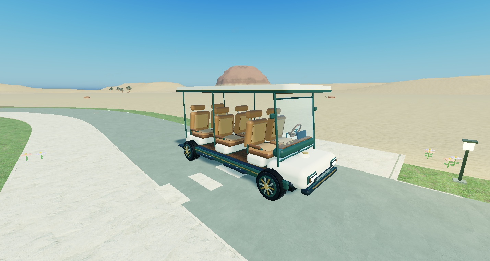

# Dig the Mountain — Quarry Garden

Актуальный проект Roblox с кольцевыми парковыми дорожками и электрокаром QG Touring.

**Открывать в Roblox Studio: [MY-ROBLOX-GAME.rbxl](MY-ROBLOX-GAME.rbxl).** Это полная карта со всеми объектами, моделями, интерфейсами и установленными скриптами.

## Файлы

- MY-ROBLOX-GAME.rbxl — основной файл игры.
- src/ — читаемый экспорт всех 67 пользовательских игровых сценариев из сохранённой сцены.
- script-manifest.json — соответствие файлов реальным экземплярам Studio, классы и настройки запуска.
- HANDOFF.md — подробный контекст для следующего разработчика и Codex.
- AGENTS.md — инструкции агенту, чтобы он продолжал существующий проект.
- COLLABORATION.md — порядок совместной работы и смены аккаунта ChatGPT.

**src/ сейчас является снимком сценариев, а не настроенным Rojo-проектом.** Редактирование Lua-файла на GitHub само по себе не меняет скрипт внутри RBXL. Изменение нужно применить в Studio и сохранить карту; экспорт кода должен соответствовать сохранённой сцене.

## Что уже готово

- Дороги вокруг горы с транспортной и пешеходной полосами.
- Одна небольшая посадочная площадка без вывесок возле спавна; стоянка 4 секунды.
- Удалена длинная зелёная обводка участка.
- QG Touring: 5 пассажирских мест, пустое водительское место, скруглённый кузов, новый салон, руление и вращение колёс, мягкий ход, приборный дисплей и свет.
- E — посадка; **Пробел — немедленный выход даже на ходу**; F — запрос/отмена высадки на площадке.
- Существующие игровые системы сохранены.

## Как работать по очереди

1. До работы: получить изменения с GitHub, затем открыть файл карты из папки репозитория.
2. После работы: остановить Play, сохранить карту в Studio, обновить экспорт изменённых сценариев и HANDOFF.md при необходимости.
3. Создать commit с описанием и выполнить Push origin.
4. Сообщить напарнику, что версия отправлена. Следующий разработчик начинает с Fetch/Pull.

Файл RBXL не следует одновременно менять в двух копиях: объединять такие изменения вручную сложно. Для вашего режима по очереди достаточно одной ветки main.

Этот снимок сохранён 15 ноября 2026 года. Более ранняя карта доступна в истории Git.
